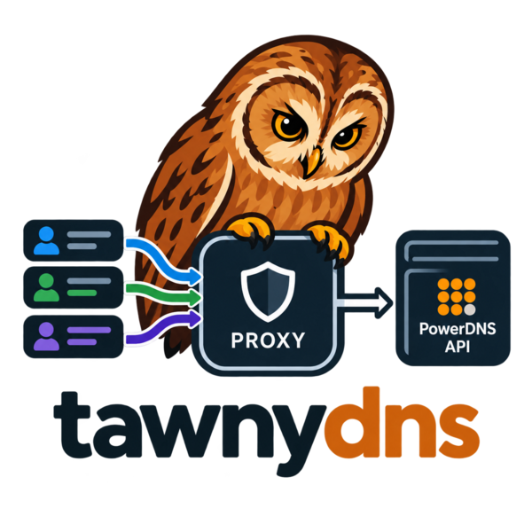

# tawnydns — the tenant-addon for PowerDNS



A multi-tenancy proxy for the [PowerDNS Authoritative HTTP API](https://doc.powerdns.com/authoritative/http-api/).

## Motivation

The PowerDNS API supports only a single API key, which grants access to everything. Out of the box, there is no way to restrict access to certain zones.

tawnydns adds support for tenants.

## Overview

tawnydns sits in front of the PowerDNS API and is transparent to clients. It accepts the `X-API-Key` header, but instead of a single API key, each tenant gets its own. If the tenant is authorized, tawnydns replaces the key with the real one.

Tenant API keys are JWTs with a list of permissions per zone: full access to the zone, access to some of its records, or only what's needed to solve ACME DNS-01 challenges.

For every request, tawnydns:

1. verifies the API key (JWT), so no state is required
2. checks that the zone in the request is one the token allows
3. inspects request bodies where needed, e.g. a tenant may create a zone it owns but not change its `kind` or `masters`
4. forwards the permitted request to PowerDNS using the real API key
5. filters responses where needed, e.g. the zone list contains only the tenant's own zones

tawnydns denies everything else (403). This includes all server-wide endpoints, such as TSIG keys, cryptokeys, metadata, config and search. Requests that carry the real PowerDNS API key are passed through unchanged, so admins can use the same endpoint.

## Usage

Run `tawnydns --help` for all commands and options. Logging is configured via the usual [`RUST_LOG` environment variable](https://docs.rs/tracing-subscriber/latest/tracing_subscriber/filter/struct.EnvFilter.html#directives), e.g. `RUST_LOG=info,tawnydns=debug`.

### Tokens

Create a key pair: the server verifies tokens with the public key, and you sign a token per tenant with the private key.

```bash
tawnydns keygen -o tawnydns.key            # writes the private key
tawnydns keygen --public -o tawnydns.pub   # writes its public key
tawnydns token create example.com          # prints a token for example.com
tawnydns token create example.com -o example.com.jwt  # or writes it to a file
```

A token can be restricted to ACME DNS-01 challenges (the TXT records `_acme-challenge.<name>`) for names relative to the zone: `@` is the zone itself, `*` any name in the zone.

```bash
tawnydns token create example.com --acme www --acme @
```

A token can also be restricted to records by name (relative to the zone, `@` is the zone itself, `*` the wildcard record) and type. Use `--any-name` or `--any-type` to lift one of the restrictions, both together grant all records, but not the zone itself (e.g. deleting it).

```bash
tawnydns token create example.com --name home --name nas --type A --type AAAA
tawnydns token create example.com --any-name --type TXT
```

A token can hold permissions for several zones: `--append` adds the permission to an existing token (signed with the same private key) and prints the new one, `-i`/`--in-place` replaces the existing token instead. The old token stays valid.

```bash
tawnydns token create example.com -o tenant.jwt
tawnydns token create --append tenant.jwt -i example.org --acme www
```

#### agenix-rekey

With [agenix-rekey](https://github.com/oddlama/agenix-rekey), the flake's `lib.agenixTokenGenerator` lets `agenix generate` create tokens from an age-encrypted private key. The decrypted key never touches the disk.

```nix
age.secrets.tawnydns-key = {
  rekeyFile = ./secrets/tawnydns.key.age;
  intermediary = true; # only used to generate tokens, not deployed
};
age.secrets.tenant-token = {
  rekeyFile = ./secrets/tenant-token.age;
  generator = inputs.tawnydns.lib.agenixTokenGenerator {
    key = config.age.secrets.tawnydns-key;
    permissions = [
      { zone = "example.com"; }
      { zone = "example.org"; acme = [ "www" ]; }
      { zone = "example.net"; names = [ "home" ]; types = [ "A" "AAAA" ]; }
    ];
  };
};
```

A permission takes the options of `tawnydns token create`: `zone`, `acme`, `names`, `anyName`, `types` and `anyType`. A newer private key regenerates the token on `agenix generate`. Changed permissions don't, use `agenix generate --force` for that.

### Server

See `tawnydns server --help` for all options.

```bash
export PDNS_API_KEY=secret          # or PDNS_API_KEY_FILE=/path/to/key
export PUBLIC_KEY_FILE=tawnydns.pub
tawnydns server --listen '[::1]:8082' --pdns-url http://localhost:8081
```

#### PowerDNS configuration

Enable the [API](https://doc.powerdns.com/authoritative/settings.html#setting-api) and set an [API key](https://doc.powerdns.com/authoritative/settings.html#setting-api-key) in `pdns.conf`. tawnydns uses the same key (`PDNS_API_KEY`):

```ini
api=yes
api-key=secret
```

The API listens on `127.0.0.1:8081` by default ([`webserver-address`](https://doc.powerdns.com/authoritative/settings.html#setting-webserver-address), [`webserver-port`](https://doc.powerdns.com/authoritative/settings.html#setting-webserver-port)). Keep it reachable only by tawnydns, so tenants can't bypass it.

## Demo

This repository contains a demo setup: PowerDNS via docker compose and an OpenTofu config in `tf/` that creates a zone as a tenant. If you use [direnv](https://direnv.net), `.envrc` sets the environment variables for you.

```bash
tawnydns keygen -o tawnydns.key
tawnydns keygen --public -o tawnydns.pub
tawnydns token create example.com > example.com.jwt

docker compose up -d   # PowerDNS on localhost:8081, API key "secret"
PDNS_API_KEY=secret PUBLIC_KEY_FILE=tawnydns.pub tawnydns server
```

Then, in another shell, apply the OpenTofu config through tawnydns:

```bash
cd tf
export PDNS_SERVER_URL=http://localhost:8082
tofu init
tofu apply -var tenant_api_key=$(cat ../example.com.jwt)
```
